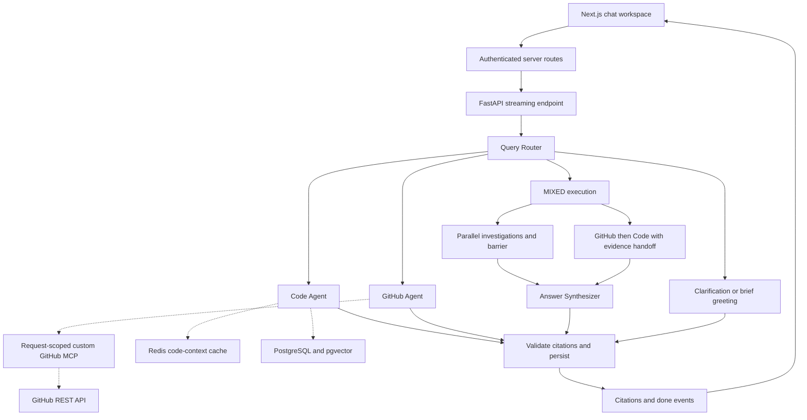
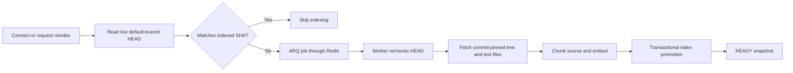

# RepoMind Project Context

**Repository:** [AdityaSaxena17/RepoMind](https://github.com/AdityaSaxena17/RepoMind)

**Updated:** 17 October 2026

**Purpose:** Reusable context for resume bullets, interviews, portfolio descriptions, and future development.

## 1. Project summary

RepoMind is a full-stack AI repository assistant. Users connect a public GitHub repository, index its source code, and ask questions about implementation, architecture, issues, and pull requests. Answers combine commit-pinned code evidence with live GitHub observations and expose verifiable citations.

The current application uses a parent LangGraph workflow with a Query Router, Code Agent, GitHub Agent, and Answer Synthesizer. It supports genuine token-by-token streaming, scoped tool discovery and authorization, iterative retrieval, Redis context caching, background indexing, and persisted conversations.

**One-line description:** A multi-agent developer assistant that explains indexed code and live GitHub activity through citation-backed, streaming conversations.

### Resume bullet options

Choose three or four bullets appropriate to the role; retain the evaluation qualifications below.

- Built a full-stack repository assistant using Next.js, TypeScript, FastAPI, and LangGraph, combining indexed source code with live GitHub issues and pull requests through repository-scoped MCP tools.
- Designed conditional CODE/GITHUB/MIXED routing with parallel specialist investigations, synchronized synthesis, and structured evidence handoffs; matched all 24 evidence-scope annotations in a development benchmark.
- Implemented hybrid pgvector and PostgreSQL full-text retrieval with Reciprocal Rank Fusion, parent-context expansion, and iterative file inspection, reaching 83.82% Recall@6 and 100% final evidence coverage on 17 applicable benchmark cases.
- Evaluated 24 repository-question scenarios using a calibrated offline LLM judge, completing all executions and grades with 99.52% groundedness and 100% citation validity.
- Reduced targeted MIXED-query time to first answer token by up to 40.4% and median input tokens by 51.2% through evidence deduplication and model-input refinement; measurements compare three targeted trials with one saved slow run.
- Added a Redis cache for indexed search/file context with a 15-minute TTL, snapshot-aware invalidation, and per-call authorization, alongside async database pooling and request-correlated model/tool timing.
- Delivered native SSE answer streaming with post-generation citation validation, atomic persistence, visible partial-failure handling, Markdown/Mermaid rendering, and resilient conversation state.

The retrieval/answer quality figures above are historical reranked benchmark results. Interactive chat currently disables reranking. These are measured development results, not a production SLA or a held-out generalization claim.

## 2. Product capabilities

- Connect public GitHub repositories by owner and name without a GitHub OAuth installation for repository access; Clerk handles application authentication.
- Index source files asynchronously and expose indexing status, indexed commit SHA, counts, timestamps, and embedding metadata.
- Explain repository purpose, architecture, feature implementation, configuration, and execution paths using indexed source code.
- Read live GitHub issues, PR details, comments, changed files, diffs, and the default-branch HEAD through a custom MCP server.
- Compare a live issue or PR with implementation in the connected repository, preserving the difference between live proposals and indexed contents.
- Maintain conversation history, source links, tool activity, request traces, and a first-response-token timer.
- Render assistant Markdown incrementally and Mermaid diagrams after generation completes, with source fallback for invalid diagrams.
- Reindex manually when GitHub HEAD differs from the indexed commit.
- Delete owned conversations and disconnect repositories while preserving data used by other accounts.

Examples of evidence routing:

| Request                                               | Evidence source                                     |
| ----------------------------------------------------- | --------------------------------------------------- |
| “Are WebSockets implemented?”                         | Code Agent: indexed implementation                  |
| “Explain its purpose and architecture.”               | Code Agent: indexed code/documentation              |
| “What commit is RepoMind using?”                      | Code Agent: indexed snapshot metadata               |
| “What is the latest commit on GitHub?”                | GitHub Agent: live default-branch HEAD              |
| “What do the comments on this PR say?”                | GitHub Agent: observed PR discussion data           |
| “How does this PR affect the indexed implementation?” | MIXED: GitHub and Code Agents                       |
| Standalone “hi” or “hello”                            | Existing clarification/reply path; no investigation |

## 3. Technology stack

| Layer                        | Technologies and responsibility                                                                       |
| ---------------------------- | ----------------------------------------------------------------------------------------------------- |
| Web application              | Next.js 16, React 19, TypeScript, Tailwind CSS                                                        |
| Identity                     | Clerk authentication and user lifecycle integration                                                   |
| API                          | FastAPI, Python 3.10+, Pydantic validation, HTTPX                                                     |
| Agent runtime                | LangGraph parent workflow and LangChain specialist agents                                             |
| Chat provider                | Configured model factory; Hive defaults to DeepSeek V4.1 Flash, with explicit OpenAI provider support |
| Code embeddings              | Local Ollama Qwen3-Embedding 0.6B, pinned weights, 1,024-dimensional vectors                          |
| Optional evaluation reranker | Qwen3-Reranker 0.6B; disabled for interactive chat                                                    |
| Persistent storage           | PostgreSQL, pgvector, Prisma for the web layer, asyncpg for Python                                    |
| Background processing        | ARQ jobs backed by Redis                                                                              |
| Context cache                | Redis cache-aside for indexed code-search and file-read results                                       |
| GitHub integration           | Custom FastMCP server using GitHub REST endpoints                                                     |
| Answer rendering             | Server-sent events, react-markdown, remark-gfm, Mermaid                                               |
| Workspace and checks         | pnpm, Turborepo, uv wrapper scripts, pytest, Ruff, mypy, ESLint, TypeScript, Prettier                 |
| Local infrastructure         | Docker Compose: PostgreSQL/pgvector, Redis, RedisInsight, pgAdmin, ARQ dashboard                      |

OpenAI embeddings remain an explicitly configurable provider for compatible historical experiments. Existing vectors are fingerprinted by embedding profile; incompatible vector spaces require reindexing/re-embedding rather than being silently mixed.

## 4. Architecture and construction boundaries



Final-answer LLM tokens stream to the UI during generation, before the final validation/persistence step shown above. The application buffers the same tokens server-side; completion events follow successful validation and persistence.

### Query Router

- Selects CODE, GITHUB, or MIXED according to the evidence required by the latest message.
- Uses the latest 20 successful conversation messages in chronological order to resolve references.
- For MIXED, chooses PARALLEL or GITHUB_THEN_CODE in the same classification call and supplies bounded specialist assignments.
- Keeps classifications and planning out of user-facing answer deltas.
- Validates structured output and permits two bounded classification attempts.
- Uses reasoning effort none with Hive; standalone greeting matches bypass the model entirely and use the existing clarification path.
- Uses history for actual references rather than treating greetings as permission to resume a previous investigation.

### Specialist factories and dynamic registry

Two ordinary functions, create_code_agent and create_github_agent, construct agents with role prompts, configured models, supplied tools, and execution limits. LangGraph invokes investigations and handles coordination; it does not own agent construction details.

The Dynamic Tool Registry owns local registration, runtime MCP discovery, tool metadata, capability filtering, guarded invocation, and request-scoped MCP session ownership.

- Supported capabilities are code.read and github.read.
- Eligibility must satisfy both trusted provider configuration and request permissions.
- Explicit custom policy metadata grants eligibility; read-only annotations alone do not.
- Eligible newly discovered tools are admitted automatically; malformed policies and name collisions are rejected.
- Repository/user identity stays outside model-controlled tool arguments.
- Authorization is checked at execution time, and tools cannot execute after their owning scope closes.
- CODE investigations do not start GitHub MCP sessions.
- Discovery has a 20-second deadline; guarded invocation has a 30-second deadline.
- Native async calls preserve tool-call IDs, callbacks, artifacts, statuses, and citation URLs.

Capability filtering is one deterministic policy. A formal Strategy class hierarchy was deferred because the current agent roles use the same selection behavior with different capability values.

### Code Agent

The Code Agent has three local tools:

| Tool                    | Purpose                                                                                          |
| ----------------------- | ------------------------------------------------------------------------------------------------ |
| search_repository_code  | Hybrid retrieval over the authorized indexed snapshot                                            |
| get_file_context        | Read a bounded, exact file range from that snapshot                                              |
| get_repository_snapshot | Read indexed SHA, branch, indexing status/time, counts, and embedding profiles without retrieval |

The agent can search repeatedly and inspect relevant callers, callees, conditions, and side effects. Application controls discourage unchanged repeated calls, require each additional read to resolve a requested fact, and reserve bounded execution capacity for completion.

### GitHub Agent

The custom MCP server exposes get_repository_head, search_issues, issue_read, search_pull_requests, and pull_request_read. Read methods cover resource details, issue/PR discussion, changed files, and PR diffs where supported.

PR get_comments reads the issue-style discussion attached to the PR. Formal reviews and inline review threads are not exposed as separate tools by the current server.

GitHub tools recheck the active user-repository relationship before requests and constrain access to the connected repository. The server is a RepoMind implementation around GitHub REST, not GitHub's official MCP server.

### Collaboration and synthesis

| Route                  | Execution                                                                   |
| ---------------------- | --------------------------------------------------------------------------- |
| CODE                   | Code Agent final generation                                                 |
| GITHUB                 | GitHub Agent final generation                                               |
| MIXED PARALLEL         | Concurrent investigations, explicit LangGraph barrier, then synthesis       |
| MIXED GITHUB_THEN_CODE | GitHub observations and affected paths passed to Code Agent, then synthesis |
| Clarification          | Brief response with no specialist investigation                             |

Parallel work uses independent tool scopes and safe database connection ownership. Sequential handoffs are untrusted evidence/context, never instructions that override the Code Agent's scope.

Each investigation returns its answer, actual observed evidence, stable citation catalog, tool records, missing information, context notes, and relevant errors. Synthesis receives this structured provenance rather than relying only on specialist prose.

## 5. Retrieval, evidence, and citations

The hybrid retriever combines:

1. Semantic similarity over pgvector embeddings.
2. PostgreSQL lexical/full-text search, including identifier and path handling.
3. Reciprocal Rank Fusion of the two candidate lists.
4. Parent file-window expansion and bounded context selection.
5. Optional parent-window reranking for explicitly enabled experiments.

The standard configuration retrieves 24 vector candidates and 24 keyword candidates and returns up to six final parent windows. Each window is bounded to 250 lines and 16,000 characters. Database operations sharing one asyncpg connection execute sequentially; agent concurrency uses independent owned connections.

The citation catalog is request-scoped. Identical evidence windows reuse identifiers and source numbers across repeated searches and file reads. Paths, inclusive line ranges, contents, and indexed commit SHA remain attached to evidence.

Deterministic validation rejects unknown source labels, invented URLs, and unobserved file ranges. Commit-pinned citation subranges must be contained in observed evidence. A separate citation-checking LLM is not used.

Recall@6 and Precision@6 evaluate the first search batch. Final evidence coverage evaluates the union of successful searches and file reads and is reported separately; it is not unbounded Recall@6.

## 6. Indexing and repository lifecycle



- The worker skips generated/dependency directories, oversized files, environment/key-like files, lockfiles, and other excluded assets.
- Text is split using 800-token chunks with 100-token overlap, retaining file and line metadata.
- Files, chunks, embeddings, commit identity, and readiness are promoted transactionally.
- Duplicate enqueue/reindex decisions are guarded, and the worker also skips downloads and embeddings when the indexed commit already matches.
- An unchanged reindex preserves the index timestamp/revision, avoiding unnecessary cache invalidation.
- Indexing failures retain explicit job/repository states and controlled errors.
- Reindexing is manual through the UI; there is no automatic push webhook for refreshing repository contents.
- Disconnecting a repository deletes the caller's chats and connection. Shared indexed data remains while another account is connected; final removal is blocked by active indexing or relevant active chat work.

## 7. Latency, caching, and streaming design

### Redis code-context caching

Indexed search/file-read results use a cache-aside design with a default 900-second TTL.

Cache identity includes the repository, indexed commit, index revision, database identity, tool arguments, embedding profile, and retrieval/reranker configuration. Changed snapshots or profiles naturally generate different keys.

A cache hit avoids repeating retrieval or the file-content read. Repository authorization and snapshot-consistency checks still access PostgreSQL before cache reuse. Cached windows receive request-local citation labels.

Redis I/O has a 250-millisecond deadline and controlled fallback to the database path. Cache entries do not contain MCP sessions, and sessions are never reused across requests. Exact tool arguments matter: repeating a conversational question can still miss if the agent chooses different searches.

### Other latency controls

- Parallel MIXED investigations overlap independent Code/GitHub work.
- Dependent MIXED requests use sequential handoffs only when live evidence must identify the implementation target.
- Exact repeated code evidence is omitted from disposable model-context projections while complete tool/evidence records remain intact.
- The code-search description encourages preserving explicit identifiers and the requested behavior.
- Specialist prompts and execution controls discourage unnecessary confirmation reads, speculative comment/diff requests, and unchanged retries.
- Ollama retains the embedding model for five minutes after use to reduce repeated cold loads; the initial load remains necessary.
- Interactive reranking is disabled to prioritize response latency.
- CODE/GITHUB stream their existing specialist final generation directly; a normal successful request adds no dedicated answer-generation call.
- A format-correction attempt is bounded by the existing execution budget if an unmarked final generation has not exposed answer text.

### SSE and persistence

The stream gate exposes only the specialist's final user-facing tokens for CODE/GITHUB and the synthesizer's final tokens for MIXED. Router output, reasoning, tool arguments, internal JSON, and intermediate agent prose remain hidden.

The backend buffers streamed text, validates completion/citations, and persists the response and citations atomically before sending citations and done. Controlled partial answers retain explicit limitations. Authorization/scope failures and cancellation are not silently treated as ordinary missing evidence.

On generation, validation, or persistence failure, the response is marked FAILED and already displayed text remains visibly unverified. The frontend does not replace a finished streamed answer with a separate history reload, and stale history responses cannot erase the active turn.

Request IDs connect browser activity with operational logs for routing, agents, model/tool durations, database reads, Redis hits/misses, and failures. These traces exclude question bodies, retrieved code, and tool arguments.

## 8. Recorded quality results

These are the strongest complete saved results from experiment **final-v12-reranked**, not fresh measurements of the current working tree.

| Metric                         | Recorded result | Applicable scope                                         |
| ------------------------------ | --------------: | -------------------------------------------------------- |
| Execution completion           |           24/24 | Every benchmark case included                            |
| Accepted offline judge grades  |           24/24 | No execution or grading failures                         |
| Router evidence-scope accuracy |            100% | 24/24 annotations matched                                |
| Answer correctness             |            100% | 22 applicable cases                                      |
| Fact completeness              |            100% | 22 applicable cases; 43 reference facts                  |
| Groundedness                   |          99.52% | 23 applicable cases                                      |
| Citation validity              |            100% | 23 applicable cases; 364/364 reference occurrences valid |
| Citation precision             |          92.10% | 23 applicable cases                                      |
| Citation coverage              |          82.37% | 23 applicable cases                                      |
| First-search Recall@6          |          83.82% | 17 applicable retrieval cases                            |
| First-search Precision@6       |          44.12% | 17 applicable retrieval cases                            |
| Final evidence coverage        |            100% | 17 applicable cases, using all successful searches/reads |
| Correct abstention             |            100% | Four applicable cases                                    |
| Unnecessary abstention         |              0% | 20 applicable cases                                      |

Scores are macro averages over applicable cases unless explicitly shown as counts. Not-applicable cases are reported separately rather than counted as successes. The workflow statuses were **21 complete and three qualified incomplete/partial answers**.

### Evaluation provenance and limits

- Frozen development benchmark: 24 questions; code corpus of 101 files and 153 chunks.
- Categories: six single-file, six architecture, four GitHub, four MIXED, and four insufficient-evidence cases.
- GitHub scenarios use strict synthetic fixtures, not recorded live GitHub issue/PR history.
- The saved run used Qwen embeddings and Qwen parent-window reranking.
- The offline judge configuration was version 4, with a matched 15-example calibration and validated structured grades.
- Graph cases start with empty conversation history; this benchmark did not establish robustness for the later real conversational greeting/history failures.
- Production context caching was disabled in evaluation; offline embedding-vector caching is a separate mechanism.
- Production executes no offline scorer or LLM judge.
- Current interactive reranking is disabled, and the later UI/router fixes have only targeted regression validation. The saved quality results must be labeled historical benchmark results.
- An independently authored holdout is still required before claiming generalization.

Dataset SHA-256: 0f1e1a8d5a7d741901a8e8d28a0673b34b6e53c5a9b190762283a67070a1a3ef.

Frozen corpus commit: 678cd4ef010ef31f9293aa8ff0c92dafd255d002.

## 9. Recorded latency and efficiency

Time to first token means time to the first native final-answer delta, not the first heartbeat, tool event, or internal model output.

| Measurement                                       | Recorded values                                 | Interpretation                                                      |
| ------------------------------------------------- | ----------------------------------------------- | ------------------------------------------------------------------- |
| Best targeted first-token improvement             | 54.83s to 32.69s; 40.4% reduction               | Fastest of three MIXED trials against one saved slow run            |
| Median first-token improvement in that experiment | 54.83s to 42.50s; 22.5% reduction               | Median across the same three trials                                 |
| Median targeted total completion time             | 57.91s to 44.56s; 23.0% reduction               | Same saved baseline and three-trial context experiment              |
| Median model input-token reduction                | 129,615 to 63,190; 51.2% reduction              | Input tokens only; not a measured total-cost reduction              |
| Cold versus warm retrieval profile                | 5.13s to 0.48s; approximately 10.6 times faster | Two uncached retrieval calls with different natural model residency |
| Complete saved benchmark median first token       | 30.33s                                          | All 24 cases in final-v12-reranked                                  |
| Complete saved benchmark median completion        | 34.63s                                          | Same full run, including all cases                                  |

The targeted latency/token reductions came from the context-projection and search-description refinement experiment. They are not a whole-benchmark speedup or an isolated causal measurement of one optimization.

Parallel agents and Redis caching are implemented performance features, but the saved timing artifacts do not isolate a standalone parallelization speedup or a Redis-specific end-to-end improvement. The warm-retrieval result is not a Redis cache hit. Provider prompt-cache token counts are also not Redis hits.

The user's later manual 22s/16s first-token observations are useful operational feedback but are not a controlled benchmark. Do not present them as measured Redis savings.

### Local source reports

| Artifact                                                                                                   | Supports                                                                   |
| ---------------------------------------------------------------------------------------------------------- | -------------------------------------------------------------------------- |
| [.eval-artifacts/final-v12-summary.json](.eval-artifacts/final-v12-summary.json)                           | Complete quality metrics and whole-run latency                             |
| [.eval-artifacts/final-v12-reranked-judged.json](.eval-artifacts/final-v12-reranked-judged.json)           | Case-level grades, judge configuration/calibration, and provenance         |
| [.eval-artifacts/final-v12-reranked.json](.eval-artifacts/final-v12-reranked.json)                         | Native graph decisions, trajectories, timings, and router-scope comparison |
| [.eval-artifacts/component-5-context-v5-summary.json](.eval-artifacts/component-5-context-v5-summary.json) | Targeted context/prompt experiment and three-trial statistics              |
| [.eval-artifacts/latency-v9-summary.json](.eval-artifacts/latency-v9-summary.json)                         | Cold/warm retrieval profile                                                |
| [.eval-artifacts/latency-v9-retrieval.json](.eval-artifacts/latency-v9-retrieval.json)                     | Residency/profile method and stage timings                                 |

These reports are local, gitignored artifacts. Archive the relevant reports separately when sharing benchmark evidence. This document embeds the approved values so its project summary remains useful without those files.

## 10. Engineering decisions and reliability

- Kept agent construction in lightweight factories and orchestration in LangGraph.
- Separated trusted tool eligibility from execution-time authorization.
- Kept MCP session ownership and cleanup inside each investigation task.
- Kept database ownership in code tools/data access, using pooled connections and read-only repeatable-read transactions for indexed snapshot consistency.
- Preserved stable citations across iterative retrieval and separated first-search metrics from final evidence coverage.
- Treated tool-returned content and cross-agent findings as untrusted evidence, not executable instructions.
- Kept specialist streaming direct to avoid an extra normal-path LLM call.
- Preserved partial answers when useful evidence exists, without weakening authorization or cancellation handling.
- Used deterministic greeting handling and clarification rather than adding more investigation intents.
- Removed the legacy single-agent production/evaluation path while preserving datasets, scoring methodology, and saved baseline reports.
- Retained synthesis reasoning high after a matched low-reasoning trial traded faster output for worse citation coverage.

Current default limits are six tool calls, eight model calls, and 120 seconds per investigation. Router attempts and MCP discovery/invocation have their own bounds; these limits are not an overall response-time guarantee.

## 11. Repository map and verification

| Location                                                               | Responsibility                                                                      |
| ---------------------------------------------------------------------- | ----------------------------------------------------------------------------------- |
| [apps/web](apps/web)                                                   | Next.js UI, authenticated server routes, conversation/repository lifecycle          |
| [apps/api/app/chat.py](apps/api/app/chat.py)                           | Chat preparation, model/provider configuration, SSE bridge, persistence             |
| [apps/api/app/orchestration.py](apps/api/app/orchestration.py)         | Router, parent graph, coordination, synthesis/citation validation                   |
| [apps/api/app/agents.py](apps/api/app/agents.py)                       | Specialist factories, prompts, execution controls, structured findings, stream gate |
| [apps/api/app/tool_registry.py](apps/api/app/tool_registry.py)         | Capability policy, discovery, guarded tools, request scopes                         |
| [apps/api/app/code_tools.py](apps/api/app/code_tools.py)               | Authorized indexed-code reads, Redis context cache, citation catalog                |
| [apps/api/app/retrieval.py](apps/api/app/retrieval.py)                 | Hybrid candidate retrieval, fusion, parent windows                                  |
| [apps/api/app/embeddings.py](apps/api/app/embeddings.py)               | Pinned local Qwen embeddings and bounded residency                                  |
| [apps/api/app/github_mcp_server.py](apps/api/app/github_mcp_server.py) | Custom GitHub REST-backed MCP tools                                                 |
| [apps/api/app/worker.py](apps/api/app/worker.py)                       | Background indexing and atomic promotion                                            |
| [apps/api/app/observability.py](apps/api/app/observability.py)         | Safe request-correlated progress and duration logging                               |
| [apps/api/app/evals](apps/api/app/evals)                               | Frozen datasets, fixtures, offline runner, scorers, calibrated judging              |
| [packages/db](packages/db)                                             | Shared Prisma schema/client                                                         |
| [docker-compose.yml](docker-compose.yml)                               | Local data services and operational dashboards                                      |

Recent targeted verification, rather than a new full quality evaluation:

- 233 deterministic API tests passed in the latest routing/greeting/final-protocol pass.
- Four real headless-browser regressions passed for streamed-message retention, late history responses, partial failures, and preserving other conversations.
- Three SSE parser/reader tests passed.
- Changed-file Ruff and formatting, strict mypy over 26 API source files, and API compilation passed.
- Frontend TypeScript, ESLint, formatting, and production build passed in the preceding frontend fix.
- Frozen pnpm lockfile verification passed during the Markdown/Mermaid dependency change.

These counts describe specific checks already run; they are not a total repository test count or a CI uptime claim.

## 12. Running the application and scope boundaries

Prerequisites include configured local environment files, application identity/model credentials, PostgreSQL/pgvector, Redis, and Ollama with the pinned Qwen embedding model.

From the repository root:

```powershell
docker compose up -d postgres redis
pnpm install
pnpm run dev
```

The dev command starts the frontend on port 3000 and API on port 8137. Run the indexing worker in a separate terminal:

```powershell
pnpm --filter api worker
```

Scope to preserve in descriptions:

- Each investigation is authorized for one connected repository. Arbitrary cross-repository comparison remains deferred.
- Live GitHub state and the indexed commit can legitimately differ.
- Reindexing is manual, not webhook-driven continuous synchronization.
- Reranking is available for experiments but disabled in interactive chat.
- There is no production LLM judge, separate Evidence Grader, or Query Rewriter.
- There are no verified production user-count, throughput, deployment-scale, indexing-throughput, or uptime claims.
- The strongest supported resume claims are the implemented architecture plus explicitly scoped development-benchmark and targeted latency results.
